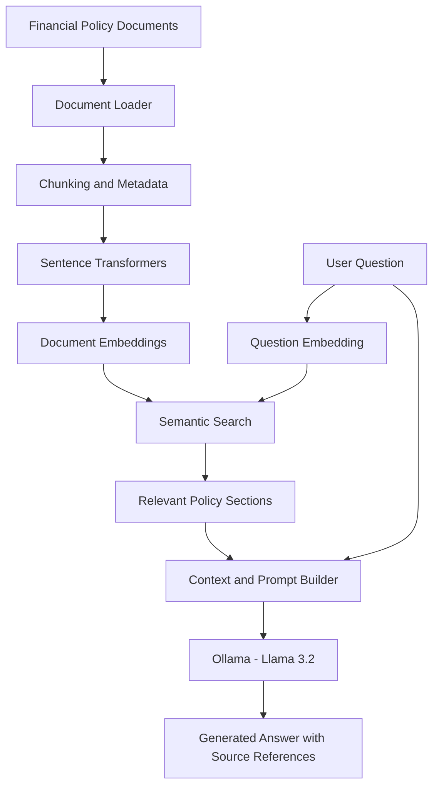

# Financial Policy AI Assistant

A Python-based Retrieval-Augmented Generation (RAG) application that helps users find and understand information in financial and cybersecurity policies.

The application uses semantic search to retrieve relevant policy sections and a locally hosted LLM to generate answers grounded in those documents.

**Project Status: Phase 4 Complete — Working Local RAG Prototype**

## Features Implemented

- Load fictional financial policy documents from text files.
- Split documents into searchable chunks.
- Preserve source filenames, section headings, and chunk IDs.
- Generate 384-dimensional embeddings using Sentence Transformers.
- Rank policy sections using cosine similarity.
- Assemble retrieved evidence into an LLM prompt.
- Generate answers locally using Ollama and Llama 3.2.
- Include policy source references in generated answers.
- Run automated tests for core application components.

## Architecture



## Technology Stack

| Technology | Purpose |
|---|---|
| Python | Core application development |
| Sentence Transformers | Text embedding generation |
| NumPy | Vector operations and similarity calculations |
| Ollama | Local language model runtime |
| Llama 3.2 3B | Natural-language answer generation |
| unittest | Automated software testing |
| Git and GitHub | Version control |

## Getting Started

### Requirements

- Python 3.12
- Git
- Ollama installed and running
- Llama 3.2 3B downloaded locally

### Installation

Clone the repository:

```bash
git clone https://github.com/AntwonLF/financial-policy-ai-assistant.git
cd financial-policy-ai-assistant
```

Create and activate a Python virtual environment:

```bash
python3 -m venv .venv
source .venv/bin/activate
```

Install dependencies:

```bash
python -m pip install -r requirements.txt
```

Download the language model:

```bash
ollama pull llama3.2:3b
```

Run the application:

```bash
python -m src.main
```

The current prototype runs a predefined demonstration question and displays retrieved policy evidence and the AI-generated response in the terminal.

## Testing

Run the automated test suite:

```bash
python -m unittest discover -s tests -p 'test_*.py' -v
```

**Latest development checkpoint: 11 automated tests passed.**

Tests cover document chunking, metadata generation, semantic search ranking, context formatting, prompt construction, and mocked LLM communication.

### Manual Evaluation

Two initial RAG evaluations were completed:

1. **MFA requirements:** The assistant correctly identified multi-factor authentication and cited the relevant policy section.
2. **Vacation allowance:** The assistant correctly stated that the information was not present in the provided policy context.

These are preliminary evaluations, not proof of general model reliability.

## Roadmap

- [x] Phase 1 — Project Setup and GitHub
- [x] Phase 2 — Document Processing and Metadata
- [x] Phase 3 — Embeddings and Semantic Search
- [x] Phase 4 — RAG and LLM Integration
- [ ] Phase 5 — Persistent Vector Database
- [ ] Phase 6 — FastAPI Backend and React Frontend
- [ ] Phase 6 Extension — Minimal Animated AI Avatar and Voice
- [ ] Phase 7 — Expanded Evaluation and Deployment

## Current Limitations

- Processes one predefined fictional text policy.
- Uses in-memory embeddings rather than a persistent vector database.
- Runs through the terminal instead of an interactive user interface.
- Generated citations are not yet independently validated.
- More extensive retrieval and answer-quality evaluation is needed.

## Data and Responsible AI

All sample policy documents are fictional and created for educational and portfolio purposes.

The application is not connected to real banking systems or confidential financial records. AI-generated answers should be verified against their cited source documents.

## Project Purpose

This project demonstrates practical AI engineering through document processing, deep-learning embeddings, semantic retrieval, prompt engineering, local LLM integration, and software testing.

Future development will expand the system into a full-stack application with a responsive React interface.
