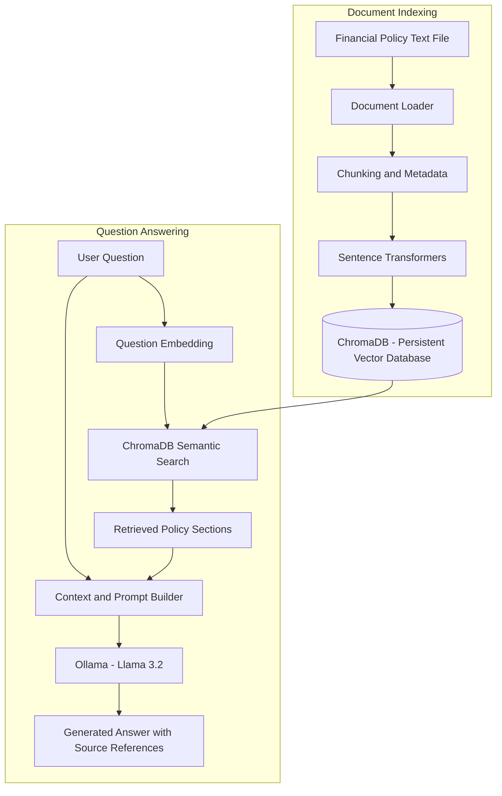

# Financial Policy AI Assistant

A Python-based **Retrieval-Augmented Generation (RAG)** application that helps users find and understand information in financial and cybersecurity policies.

The application uses semantic search to retrieve relevant policy sections from a persistent vector database, then uses a locally hosted large language model (LLM) to generate answers grounded in those documents.


<!-- START PROJECT STATUS -->

## Current Project Status

**Phase:** 5 — Persistent Vector Database (Complete)

**Automated Tests:** 13 passing

**Latest Accomplishments:**
- Integrated persistent ChromaDB vector storage.
- Indexed nine fictional banking policy sections.
- Connected database retrieval to the RAG pipeline.
- Verified source-grounded answers using Llama 3.2.
- Tested database persistence and duplicate prevention.

**Next Phase:** Phase 6 — FastAPI and React Frontend

<!-- END PROJECT STATUS -->


## Features Implemented

- Load a fictional financial policy from a text file.
- Split policy documents into searchable chunks.
- Preserve source filenames, section headings, and chunk IDs.
- Generate 384-dimensional embeddings using Sentence Transformers.
- Store policy text, embeddings, and metadata in a persistent ChromaDB collection.
- Re-index policy chunks using stable IDs without creating duplicate records.
- Retrieve relevant sections from ChromaDB using cosine-distance vector search.
- Assemble retrieved evidence into a structured LLM prompt.
- Generate answers locally using Ollama and Llama 3.2 (3B).
- Ask the model to include policy source references in generated answers.
- Run automated tests for document processing, retrieval, prompting, LLM communication, and database behavior.

## Architecture

The system separates **indexing** (preparing and storing documents) from **question answering** (retrieving stored evidence and generating a response).



### How It Works

1. **Index documents:** `src.index_policies` loads the sample policy, creates chunks and metadata, generates embeddings, and stores them in ChromaDB.
2. **Ask a question:** The current terminal prototype uses a predefined question in `src.main`.
3. **Retrieve evidence:** The question is embedded, and ChromaDB returns the most similar stored policy sections.
4. **Generate an answer:** The retrieved text and source information become the context for Llama 3.2.
5. **Review the result:** The generated answer is displayed alongside the retrieved evidence. Source references are model-generated and are not yet automatically validated.

## Technology Stack

| Technology | Purpose |
|---|---|
| Python 3.12 | Core application development |
| Sentence Transformers | Text embedding generation |
| NumPy | Vector operations and testing |
| ChromaDB | Persistent storage and semantic vector retrieval |
| Ollama | Local language model runtime |
| Llama 3.2 (3B) | Natural-language answer generation |
| `unittest` | Automated software testing |
| Git and GitHub | Version control and collaboration |

## Getting Started

### Requirements

- Python 3.12 and Git
- Ollama installed and running locally
- Llama 3.2 (3B) downloaded through Ollama

### Installation

Clone the repository:

```bash
git clone https://github.com/AntwonLF/financial-policy-ai-assistant.git
cd financial-policy-ai-assistant
```

Create and activate a Python virtual environment (macOS/Linux):

```bash
python3 -m venv .venv
source .venv/bin/activate
```

Install dependencies:

```bash
python -m pip install -r requirements.txt
```

Download the local language model and ensure Ollama is running:

```bash
ollama pull llama3.2:3b
```

**Build the local vector database first.** The `chroma_db/` directory is generated locally and is not committed to Git:

```bash
python -m src.index_policies
```

The sample policy should produce **9 stored chunks**. Repeating the indexing command updates existing IDs rather than creating duplicates.

Run the application:

```bash
python -m src.main
```

The current prototype runs a **predefined demonstration question** and displays retrieved policy evidence and the AI-generated answer in the terminal. It does not yet have an interactive web interface.

## Testing

Run the complete automated test suite:

```bash
python -m unittest discover -s tests -p 'test_*.py' -v
```

**Latest development checkpoint: 13 automated tests passed.**

Tests cover document chunking, source metadata, semantic ranking, context formatting, prompt construction, mocked LLM communication, ChromaDB persistence, duplicate prevention, and database retrieval. The database tests use an isolated temporary collection rather than modifying the development database.

### Manual RAG Evaluation

Initial manual checks included:

1. **Account termination:** Correctly identified the 24-hour account-disabling requirement and cited Section 3.
2. **MFA requirements:** Correctly identified multi-factor authentication and cited Section 2.
3. **Vacation allowance:** Stated that the information was not found in the provided policy context rather than inventing a requirement.

These are preliminary checks, **not** a comprehensive measurement of model accuracy or reliability.

## Roadmap

- [x] Phase 1 — Project Setup and GitHub
- [x] Phase 2 — Document Processing and Metadata
- [x] Phase 3 — Embeddings and Semantic Search
- [x] Phase 4 — RAG and LLM Integration
- [x] Phase 5 — Persistent Vector Database
- [ ] Phase 6 — FastAPI Backend and React Frontend
- [ ] Phase 6 Extension — Minimal Animated AI Avatar and Optional Voice
- [ ] Phase 7 — Expanded Evaluation and Deployment

## Current Limitations

- Processes one predefined fictional text policy; additional document formats and multi-document ingestion are not yet implemented.
- Runs a predefined question through the terminal, not a user-facing web application.
- The vector database is built locally through a separate indexing command; automatic document-change detection is not yet implemented.
- Citations are requested in the prompt but are not yet independently checked against the retrieved records.
- More extensive retrieval evaluation, unsupported-question handling, and answer-quality testing are needed.

## Data and Responsible AI

All sample policies are **fictional** and created for educational and portfolio purposes.

The application is not connected to real banking systems or confidential financial records. Generated answers should be checked against the original policy text before being used for real decisions.

## Project Purpose

This project demonstrates applied AI engineering through document processing, deep-learning embeddings, persistent vector retrieval, prompt engineering, local LLM integration, and software testing.

Future work will extend it into a full-stack application with FastAPI, React, a responsive interface, and a minimal animated assistant.
